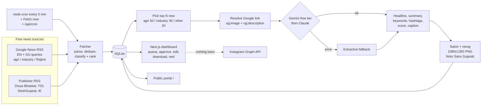

# Gujarat News Studio

**Live Gujarat news → AI summary → branded 1080×1350 frames → team approval.** Built as a working client demo on a 100% free stack.

Agriculture is the primary focus (mandi/APMC prices, mainly Rajkot and Gondal yards, monsoon impact, cotton, groundnut, jeera, irrigation, schemes, dairy). Industry comes second, and Rajkot/Saurashtra gets the top geographic boost.

## Features

| Area | What it does |
| --- | --- |
| **Live fetch** | 22 verified free RSS feeds: Google News searches in English and Gujarati (`hl=gu`) for agriculture, APMC/yards, industry, Rajkot and general Gujarat news, plus Divya Bhaskar, TOI (Ahmedabad, Rajkot, Surat, Vadodara), DeshGujarat and Indian Express Ahmedabad. Sandesh and Gujarat Samachar have no working public RSS, so they are pulled via Google News `site:` searches. Sources are editable in **Settings**. |
| **Scheduler** | An in-app scheduler (`node-cron`, started from `instrumentation.ts`) runs every 5 minutes. There is also a **Fetch now** button, a protected `/api/cron` endpoint and an example GitHub Actions workflow. |
| **Dedupe + ranking** | Each story is deduped by link hash and by normalised-title hash (the same story across feeds). Ranking gives agriculture +6, industry +4.5 and Rajkot/Saurashtra +3, with a bonus for recent stories. Each run fills about 50% agri, 30% industry and 20% other. |
| **AI summary** | **Google Gemini free tier** (default `gemini-3.5-flash-lite`, one JSON call per unique story, throttled to ~8 requests/min, backs off on 429), then optional Claude (`claude-haiku-4-5-20251001`, used only if it has credit), then the extractive fallback. Set the provider and models in Settings or with `AI_PROVIDER` / `GEMINI_MODEL`. Older fallback posts are re-summarised with AI a few per run (`AI_BACKFILL_PER_RUN`). The AI writes a headline, a 2–3 line summary, 5–8 keywords, hashtags, a category, a 1–10 postworthy score and an Instagram caption. You can switch output between Gujarati and English per workspace, or regenerate one post in either language. Only new items are processed, capped at `MAX_ITEMS_PER_RUN` (10) per run. |
| **No source in Instagram output** | The portal shows and links the original publisher, but frames, reels, captions and hashtags never mention the source. The prompt forbids it, and a scrubber removes publisher names, URLs and "via X" from all AI and fallback output. |
| **Never breaks** | If the AI provider errors (no key, quota, retired model), an **extractive summariser** takes over automatically, with a 15-minute back-off. The UI shows which summariser made each post. |
| **Media** | Image priority: RSS `media:content`/`enclosure`, then the article's `og:image` (Google News links are resolved to the publisher URL first), then a branded gradient placeholder. ffmpeg normalises images (webp to jpeg, ≤1080px). |
| **Frames** | Server-side PNG rendering with **Satori + resvg** and bundled **Noto Sans + Noto Sans Gujarati**, so Gujarati conjuncts render correctly. There are 3 templates: *Breaking Bold*, *Clean Card* and *Mandi Bulletin*. Brand name, handle, tagline, colours and logo are editable. |
| **Reel (optional)** | One click makes a 6-second 1080×1350 MP4 (slow zoom) with ffmpeg. |
| **Dashboard** | Overview stats, a post queue with frame previews, Approve/Reject, Edit (headline, summary, keywords, caption, template, with re-render), PNG download, copy caption, live feed, activity log and run history. |
| **Public portal** | `/` is a public news homepage: 🌾 Agriculture & Mandi first, then 🏭 Industry, 📍 Rajkot & Saurashtra and Latest, with a live ticker. |
| **Teams** | Login with Admin / Editor / Viewer roles. A **workspace switcher** keeps each business's sources, brand and queue separate. |
| **Instagram** | Stubbed. There is a disabled *"Post to Instagram (coming soon)"* button, and `lib/instagram.ts` documents the Graph API flow. |

## Demo logins (demo credentials only)

| Email | Password | Role |
| --- | --- | --- |
| admin@demo.com | demo1234 | Admin: everything incl. settings, sources, users, workspaces |
| editor@demo.com | demo1234 | Editor: fetch, approve/reject, edit, render |
| viewer@demo.com | demo1234 | Viewer: read-only |

## Run locally

```bash
npm install
cp .env.example .env.local      # add ANTHROPIC_API_KEY (optional) and a CRON_SECRET
npm run build && npm start      # http://localhost:3000
```

The SQLite DB (`data/app.db`), rendered frames and media cache are created automatically and seeded on first boot. Zero external services are needed. `ffmpeg` is needed for webp images and reels; without it those features degrade gracefully.

Keep it running with auto-restart and expose it publicly for free:

```bash
nohup scripts/run-forever.sh > logs/supervisor.log 2>&1 &
CLOUDFLARED=/path/to/cloudflared nohup scripts/tunnel-forever.sh > logs/tunnel.log 2>&1 &
grep -o 'https://[a-z0-9-]*\.trycloudflare\.com' logs/tunnel.log | head -1
```

## Environment variables

| Var | Default | Purpose |
| --- | --- | --- |
| `AI_PROVIDER` | `auto` | `auto` (Gemini → Claude → fallback), `gemini`, `claude` or `extractive` |
| `GEMINI_API_KEY` | – | Google Gemini key (free tier) |
| `GEMINI_MODEL` | `gemini-3.5-flash-lite` | Gemini model (falls back to `gemini-flash-lite-latest` if retired or overloaded) |
| `GEMINI_MIN_GAP_MS` | `7000` | Throttle between Gemini calls |
| `AI_BACKFILL_PER_RUN` | `3` | Older fallback posts upgraded with AI per run |
| `ANTHROPIC_API_KEY` | – | Claude key. Optional |
| `ANTHROPIC_MODEL` | `claude-haiku-4-5-20251001` | Default model (also editable per workspace) |
| `AUTH_SECRET` | auto-generated into the DB | Session signing secret |
| `CRON_SECRET` | – | Bearer token for `/api/cron` |
| `FETCH_INTERVAL_MINUTES` | `5` | In-app scheduler interval (`0` = off, use external cron) |
| `MAX_ITEMS_PER_RUN` | `10` | Cost control: new stories summarised per run |
| `DATA_DIR` | `./data` | SQLite DB, frames and media cache |
| `PORT` | `3000` | HTTP port |

## Architecture



Code map: `lib/fetcher.ts` (RSS, dedupe, Google link resolver, og tags) · `lib/classify.ts` (agri/industry/Rajkot ranking) · `lib/summarize.ts` (Gemini, Claude, fallback, source scrubber) · `lib/render.tsx` (frame templates) · `lib/pipeline.ts` (orchestration) · `lib/scheduler.ts` · `lib/db.ts` (schema + seed) · `lib/instagram.ts` (stub).

## Deploy permanently for free (later)

The app needs a **long-running Node process** (scheduler, native `better-sqlite3`/`resvg`, ffmpeg) and a **persistent disk** for SQLite.

1. **Oracle Cloud Always Free VM** (best free option). Install Node 20+ and ffmpeg, `npm ci && npm run build`, run with `pm2 start npm -- start`, and put Caddy in front for HTTPS, or use a *named* Cloudflare Tunnel with a free Cloudflare account for a stable URL.
2. **Render free web service / Railway trial.** Deploy from this repo (build `npm ci && npm run build`, start `npm start`). Free instances sleep and have ephemeral disks, so set `FETCH_INTERVAL_MINUTES=0`, enable the GitHub Actions workflow (`.github/workflows/cron.yml`, secrets `APP_URL` + `CRON_SECRET`) to wake it, and attach a disk or move storage to a hosted DB.
3. **Vercel + Turso (libSQL) + Vercel Blob.** Swap `better-sqlite3` for `@libsql/client` (same SQL), store PNGs in Blob instead of `data/frames`, drop the in-app scheduler and use GitHub Actions or Vercel Cron to call `/api/cron`. Reels need ffmpeg, so keep that on a worker.

A Cloudflare *quick* tunnel (what the demo uses) is free but its URL changes whenever the tunnel restarts.

## Instagram roadmap

1. Convert the client's Instagram to a **Business/Creator** account and link it to a **Facebook Page**.
2. Create a **Meta app** and request `instagram_basic`, `instagram_content_publish` and `pages_show_list` (App Review takes about 1–3 weeks, so start early).
3. Store a long-lived token per workspace and implement `lib/instagram.ts`: `POST /{ig-user-id}/media` with `image_url` (our public `/api/frame/:id` PNG) + `caption`, then `POST /{ig-user-id}/media_publish`. Reels use `media_type=REELS` + `video_url`.
4. Respect the ~50 posts/24h API limit: post the best story every 30–60 minutes and move the rest to Stories or a carousel digest.
5. Add scheduling slots, auto-publish for approved posts above a score threshold, and insights back into the dashboard.
